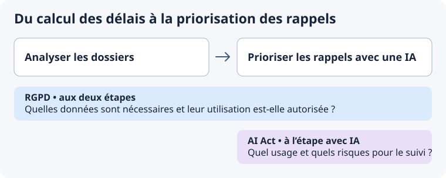
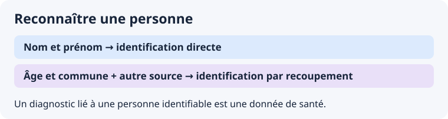
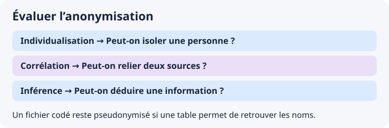
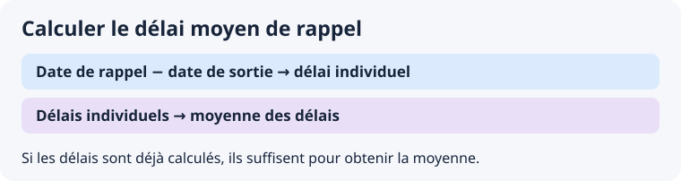
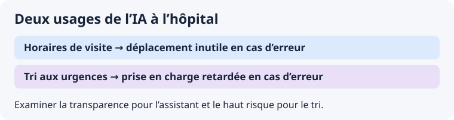
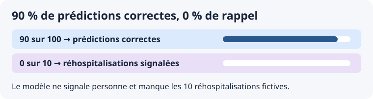

1. Deux règlements pour deux questions

Un hôpital veut d’abord analyser des dossiers de patients pour comprendre les retards de suivi. Ensuite, il envisage d’utiliser une IA qui suggère quels patients rappeler en priorité.
Le RGPD s’applique dès l’analyse des dossiers
L’hôpital a-t-il le droit d’utiliser ces données pour cet objectif précis, et de quelles informations a-t-il réellement besoin ?
Même si l’équipe travaille dans un simple tableur, le RGPD s’applique si les patients sont identifiables. L’hôpital doit définir l’objectif de l’analyse, s’appuyer sur une base juridique (article 6) et limiter les informations utilisées au nécessaire (article 5). Les données de santé sont particulièrement protégées. L’hôpital doit aussi vérifier qu’une exception prévue à l’article 9 autorise leur traitement. Par exemple, si le but est de calculer le délai moyen entre la sortie et le rappel, les deux dates peuvent suffire au calcul sans afficher le nom des patients ni leur diagnostic.
Source officielle — RGPD, règlement (UE) 2016/679, articles 5, 6 et 9.

L’AI Act ajoute une question sur le système
À quoi sert l’IA, quels risques ses suggestions créent-elles pour les patients, et quelles règles s’appliquent à cet usage ?
Si l’outil classe trop bas un patient qui a besoin d’un suivi rapide, le rappel peut être retardé. L’équipe doit examiner le rôle de la suggestion dans la décision et vérifier si le système relève d’une catégorie à haut risque. Le tri des patients aux urgences figure à l’annexe III. Pour une liste de rappels après la sortie, il faut examiner l’usage prévu et les critères de l’article 6 avant de conclure. Les systèmes à haut risque sont notamment soumis à des exigences de gestion des risques et de contrôle humain. Le RGPD continue de s’appliquer aux données personnelles utilisées par l’IA.
Source officielle — AI Act, règlement (UE) 2024/1689, articles 2, 6, 9 et 14 et annexe III.

Petit exercice
L’équipe ajoute les diagnostics au tableau qui sert à calculer le délai moyen de rappel. Ensuite, une IA classe un patient nécessitant un suivi rapide en bas de sa liste. À quel règlement rattaches-tu chacune des questions soulevées par ces deux situations ?

Réponse attendue. Le RGPD invite à vérifier si les diagnostics sont nécessaires au calcul et si leur utilisation est autorisée. L’AI Act invite à examiner le risque qu’une mauvaise suggestion retarde le suivi, ainsi que les règles applicables à cet usage de l’IA.

2. Reconnaître une donnée personnelle
Le RGPD appelle donnée personnelle toute information qui se rapporte à une personne identifiée ou identifiable. On peut reconnaître cette personne directement ou en combinant plusieurs informations auxquelles on peut raisonnablement accéder.
Que révèle chaque information ?
Information dans le dossier	Comment peut-elle aider à reconnaître la personne ?
Nom et prénom	Ils peuvent identifier directement la personne. En cas d’homonymie, une autre information peut être nécessaire.
Âge	Seul, un âge comme 47 ans correspond à de nombreuses personnes. Associé à la commune ou à d’autres renseignements, il peut aider à retrouver la personne.
Commune	Seule, elle désigne un lieu. Associée à l’âge, elle peut permettre de reconnaître quelqu’un, notamment dans une petite commune si on dispose d’une autre liste.
Diagnostic	Il renseigne sur l’état de santé. S’il est rare, il peut aussi aider à reconnaître la personne lorsqu’on le recoupe avec d’autres informations.

L’âge et la commune sont déjà des données personnelles lorsqu’ils figurent dans le dossier d’une personne identifiable. Si l’hôpital retire le nom, il faut encore vérifier si quelqu’un peut raisonnablement reconnaître le patient grâce aux informations restantes.
Pourquoi le diagnostic est-il une donnée de santé ?
Le diagnostic est une donnée de santé parce qu’il révèle une information sur l’état de santé physique ou mentale d’une personne identifiable. Par exemple, « diabète de type 2 » dans un manuel décrit une maladie. Le même diagnostic dans le dossier d’un patient identifiable révèle une information sur sa santé. Le RGPD prévoit une protection particulière pour ces données à l’article 9.

Source officielle — RGPD, règlement (UE) 2016/679, article 4 (points 1 et 15), article 9 et considérants 26 et 35.

Petit exercice
L’hôpital retire le nom d’une ligne contenant « 47 ans, commune de Val-des-Prés, diabète de type 2 ». Une personne qui a accès au tableau dispose aussi d’une liste nominative des habitants où une seule personne de cette commune a 47 ans. Peut-elle retrouver de qui il s’agit ? Le diagnostic est-il toujours une donnée de santé ?

Réponse attendue. Oui. Elle peut faire le lien entre les deux listes grâce à l’âge et à la commune. Le diagnostic reste une donnée de santé puisqu’il révèle une information médicale sur la personne ainsi identifiée.

3. Pseudonymiser n’est pas anonymiser
L’hôpital remplace le nom de chaque patient par un code et conserve séparément la table qui relie les codes aux noms. Le fichier transmis à l’équipe est pseudonymisé. L’hôpital peut retrouver les noms à l’aide de la table. Le fichier contient donc toujours des données personnelles et le RGPD continue de s’appliquer.
Comment reconnaître un patient sans la table ?
Imaginons qu’une ligne mentionne le code P037, l’âge exact de 102 ans et une petite commune. Si un bulletin communal a publié le nom et l’âge de la seule personne de 102 ans qui y habite, on peut rapprocher les deux sources. Ce recoupement permet d’associer le diagnostic de la ligne à la personne nommée dans le bulletin. Les dates précises d’hospitalisation ou un diagnostic rare peuvent aussi faciliter un rapprochement avec une autre source.
Comment évaluer l’anonymisation ?
Pour parler d’anonymisation, il faut que l’identification ne soit plus possible en pratique avec les moyens raisonnablement utilisables. La CNIL propose d’examiner trois possibilités.
- Individualisation — Peut-on isoler un patient dans le fichier, par exemple grâce à un âge exceptionnel ?
- Corrélation — Peut-on relier ses données à celles d’une autre source, comme le bulletin communal ?
- Inférence — Peut-on déduire avec une quasi-certitude une information sur ce patient, par exemple son diagnostic si tous les membres du petit groupe auquel on sait qu’il appartient ont le même diagnostic ?
Source officielle — CNIL, L’anonymisation de données personnelles.

Petit exercice
L’équipe ne reçoit jamais la table qui associe les codes aux noms. Elle apprend qu’un bulletin communal identifie la seule personne de 102 ans dans la commune de P037. Quelles informations permettent le rapprochement ? Quel critère de la CNIL est illustré ?

Réponse attendue. L’âge exact et la commune permettent de relier la ligne au bulletin. C’est un exemple de corrélation entre deux sources.

4. Définir l’usage des dossiers
Avant d’extraire des données, l’hôpital précise pourquoi il en a besoin. Calculer le délai moyen entre une sortie et un appel est un objectif différent de prédire quels patients risquent une réhospitalisation. Si l’hôpital veut réutiliser les dossiers pour cette nouvelle finalité, il doit vérifier à quelles conditions cette réutilisation est autorisée. Pour un traitement de données de santé, il lui faut une base juridique au titre de l’article 6 et une exception applicable au titre de l’article 9.

Le principe de minimisation consiste à limiter les données à celles qui sont nécessaires à l’objectif. Pour calculer le délai de rappel, l’équipe peut travailler avec les deux dates, ou avec le délai déjà calculé. Elle peut écarter le nom, le numéro de téléphone et le diagnostic si ces champs ne sont pas nécessaires au calcul.

Source officielle — RGPD, articles 5, 6 et 9.

Petit exercice
L’équipe veut calculer le délai moyen de rappel à partir d’un tableau avec le nom, le téléphone, les dates de sortie et de rappel, et le diagnostic. Quels champs conserver pour le calcul ?

Réponse attendue. Les deux dates suffisent pour calculer le délai. Si le délai figure déjà dans le tableau, il suffit à lui seul pour calculer la moyenne.

5. Protéger les personnes et organiser le travail
L’hôpital limite les accès selon les tâches de chacun. Voici une répartition possible.
Rôle	Données nécessaires à la tâche
Équipe soignante chargée des rappels	Identité, coordonnées et éléments cliniques utiles au suivi des patients dont elle a la charge.
Équipe d’analyse	Données strictement nécessaires à l’étude, pseudonymisées lorsque c’est possible. Pour une moyenne de délais, les délais seuls peuvent suffire.
Personnes habilitées à gérer les correspondances	Table qui relie les codes aux identités, conservée à part avec un accès restreint.

Des comptes nominatifs et des droits par rôle permettent de savoir qui peut consulter chaque fichier. L’hôpital peut journaliser les accès, revoir les habilitations et les retirer lorsqu’une personne change de fonction.

Si un patient signale une donnée inexacte, il peut exercer son droit de rectification (article 16). Il adresse sa demande à l’hôpital, responsable du traitement, via le canal prévu dans la notice de confidentialité. Il peut aussi contacter le délégué à la protection des données (DPD ou DPO) de l’hôpital au sujet de sa demande. L’hôpital peut faire vérifier une erreur clinique par le service compétent.

Source officielle — RGPD, articles 5, 16, 32 et 38.

Petit exercice
Un analyste demande les numéros de téléphone pour calculer un délai moyen. Un patient signale que son adresse est erronée. Que réponds-tu à chacun ?

Réponse attendue. L’analyste peut calculer la moyenne avec les délais seuls. Le patient peut demander la rectification de son adresse auprès de l’hôpital et contacter son DPD.

6. Comprendre l’AI Act à partir des usages
La destination du système correspond à l’usage pour lequel il est conçu. Dans le même hôpital, deux IA peuvent donc soulever des questions très différentes.
Usage prévu	Effet possible d’une erreur	Obligations à examiner
Répondre aux questions sur les horaires de visite	Un visiteur peut se déplacer pour rien. L’outil diffuse des informations pratiques.	Pour un assistant qui échange avec le public, l’article 50 prévoit d’informer les utilisateurs qu’ils interagissent avec une IA, sauf si cela ressort clairement du contexte.
Aider à fixer l’ordre de passage aux urgences	Une mauvaise priorité peut retarder la prise en charge d’un patient.	Le tri des patients aux urgences figure à l’annexe III, point 5 d). Si l’outil influence l’ordre de passage, il relève en principe du haut risque. Il faut examiner notamment la gestion des risques, la qualité des données, le contrôle humain et les obligations de l’hôpital en tant que déployeur.

Le fait qu’un soignant valide la priorité fait partie de l’organisation du contrôle humain. Pour déterminer les règles applicables, il faut aussi examiner l’influence réelle de la suggestion sur la décision.

Sources officielles — Présentation de l’AI Act par la Commission européenne et règlement (UE) 2024/1689, articles 6, 9, 10, 14, 26 et 50 et annexe III.

Petit exercice
L’assistant des horaires reçoit une nouvelle fonction qui classe les patients aux urgences par ordre de passage. Quelle partie de son usage faut-il réexaminer ?

Réponse attendue. Il faut examiner la fonction de triage au regard des règles sur le haut risque, car ses suggestions peuvent modifier le délai de prise en charge.

7. Évaluer une IA au-delà de sa performance globale
Sur 100 patients, 10 sont réhospitalisés. En prédisant « aucune réhospitalisation » pour tous, le modèle classe correctement 90 patients sur 100. Dans cet exercice, si les réhospitalisations servent de repère pour évaluer quels patients auraient dû être signalés, il en a repéré zéro sur dix.

Le rappel, ou sensibilité, mesure la part des patients effectivement réhospitalisés que le modèle a signalés. Ici, le rappel vaut 0 ÷ 10 = 0 %. Les 10 cas manqués sont des faux négatifs. La part de cas manqués est le complément du rappel dès qu’il y a au moins un cas positif observé.

Pour comparer les tranches d’âge, utilise les mêmes règles de prédiction et la même période de suivi dans un jeu de test distinct de l’entraînement. Dans chaque tranche, divise le nombre de patients réhospitalisés et manqués par le nombre total de patients réhospitalisés. Compare les proportions et indique les effectifs. Une tranche avec très peu de réhospitalisations peut donner un taux instable. Si aucune réhospitalisation n’y est observée, le taux n’est pas calculable.

Sources — Google for Developers, rappel et faux négatifs et guide HAS–CNIL sur le bon usage de l’IA en contexte de soins.

Petit exercice
Dans un second test, le modèle manque 2 patients sur 4 réhospitalisés chez les moins de 65 ans et 2 sur 6 chez les 65 ans et plus. Pour quelle tranche la part de cas manqués est-elle la plus élevée ?

Réponse attendue. Chez les moins de 65 ans, avec 50 % de cas manqués contre environ 33 % chez les 65 ans et plus. Les effectifs sont trop faibles pour tirer une conclusion solide sur un écart durable.

8. Appliquer les notions à un projet
Je conseillerais à l’hôpital de commencer par un test rétrospectif, à condition d’avoir établi que les données peuvent être utilisées à cette fin. Les résultats du test restent en dehors du circuit de décision sur les rappels.
1. Définir l’objectif et les données utiles. Avec l’équipe soignante et le DPD, préciser ce que l’outil doit aider à repérer, vérifier la base juridique et la condition applicable aux données de santé, puis examiner si une analyse d’impact est requise. Si l’objectif est de prévoir une réhospitalisation à 30 jours, les données de test peuvent inclure la date de sortie, des informations pertinentes connues au moment de la prédiction et l’issue observée dans les 30 jours. Cette issue sert à vérifier la prédiction. Les analystes peuvent travailler avec des données pseudonymisées et des accès limités.
2. Vérifier les cas manqués avant tout usage en soins. Tester le modèle sur des dossiers plus récents que ceux utilisés pour l’entraînement. À nombre de rappels comparable, mesurer combien de patients réhospitalisés le modèle repère et combien il manque, globalement et par tranche d’âge. Comparer ces résultats au processus actuel si les données le permettent. L’équipe clinique doit aussi vérifier si la réhospitalisation constitue un bon repère pour le besoin réel de suivi.
3. Décider des suites avec l’équipe de soins. Pour trancher, il faut connaître le nombre de patients que l’équipe peut rappeler, le niveau de cas manqués acceptable, les effectifs par tranche d’âge et la manière dont le score pèserait sur les décisions. Ces éléments aident à juger l’utilité du système et à examiner son statut au regard de l’AI Act. Si le test est concluant, un essai en conditions réelles peut d’abord mesurer les suggestions sans modifier les rappels.
Sources officielles — RGPD, articles 5, 6, 9 et 35, AI Act, article 6 et guide HAS–CNIL sur le bon usage de l’IA en contexte de soins.

Petit exercice
Le modèle obtient 90 % de prédictions correctes, mais l’équipe ignore combien de patients réhospitalisés il manque. Quelle vérification demandes-tu avant de modifier les rappels ?

Réponse attendue. Mesurer le rappel et les cas manqués sur des dossiers de test distincts de ceux de l’entraînement, globalement et par tranche d’âge, puis examiner ces résultats avec les soignants au regard de la capacité de rappel.
